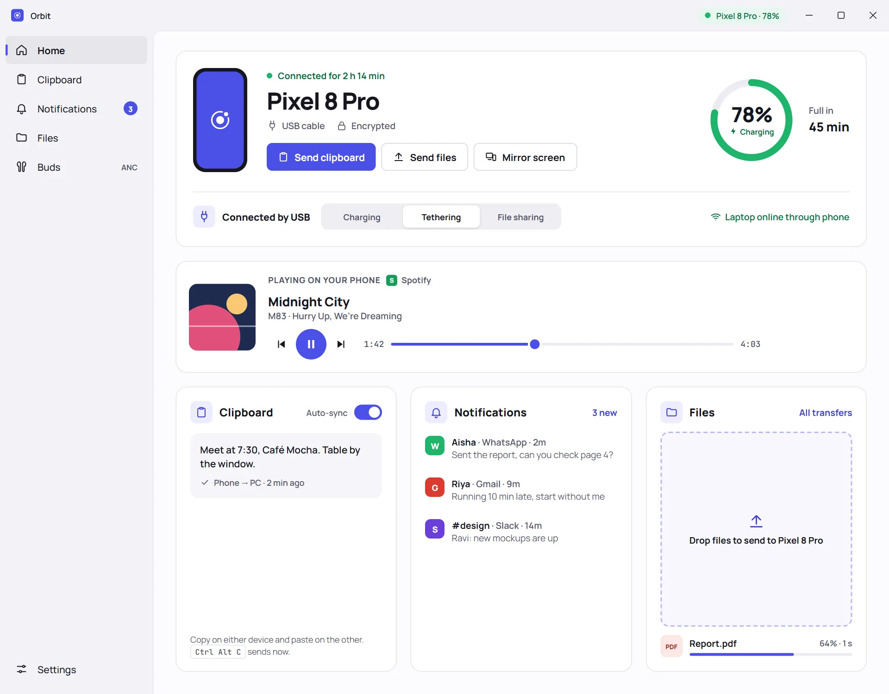
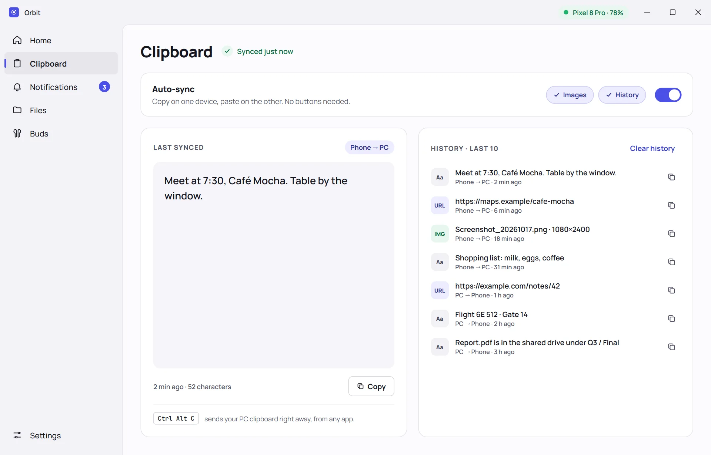
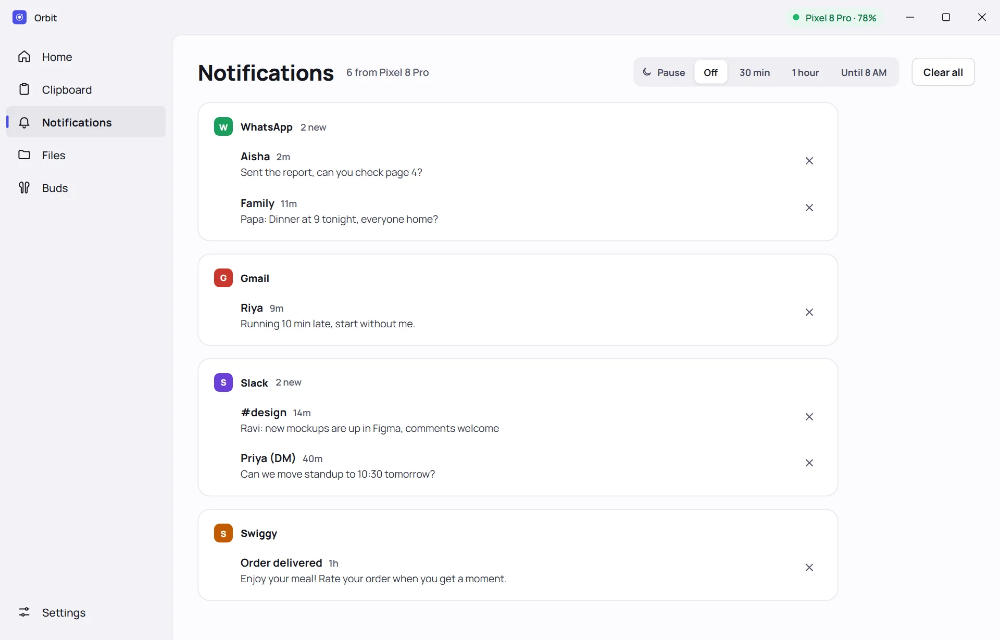
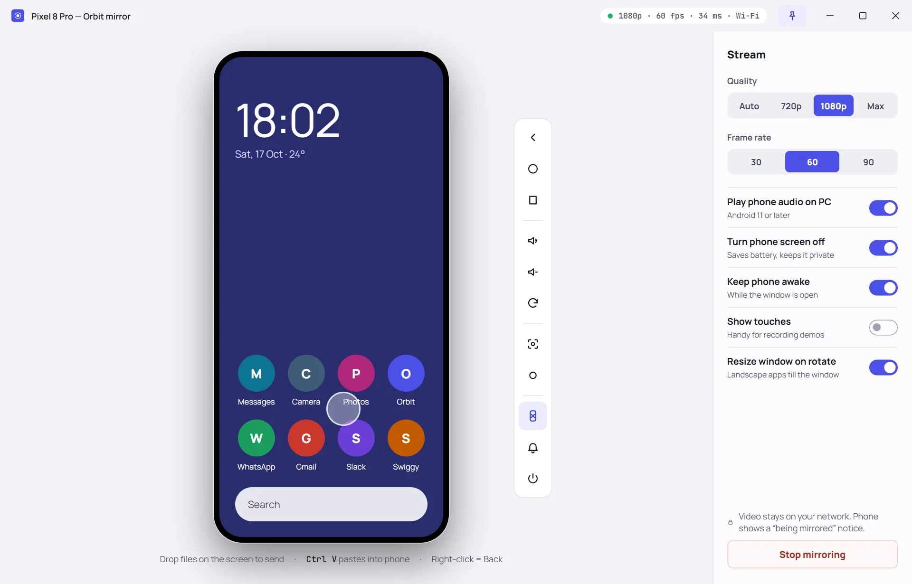
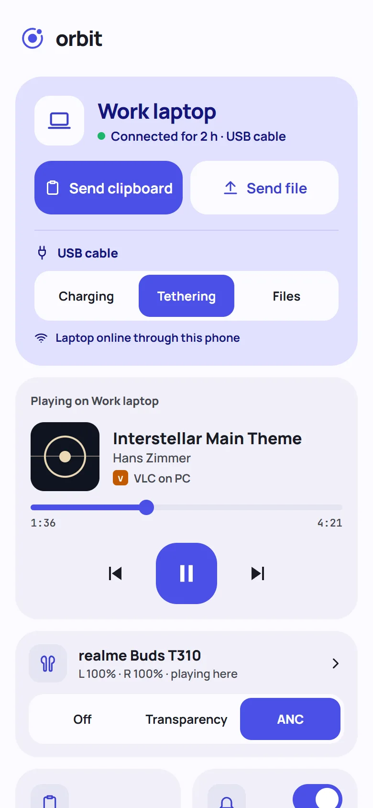
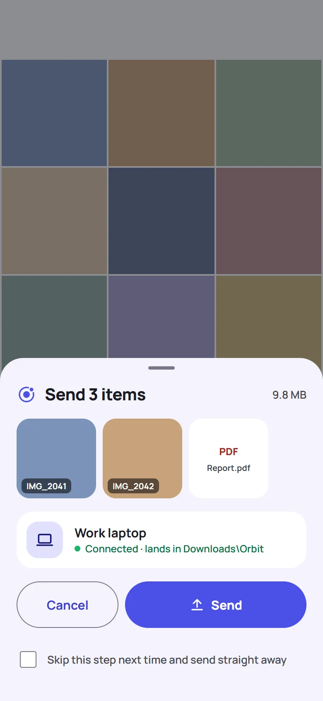
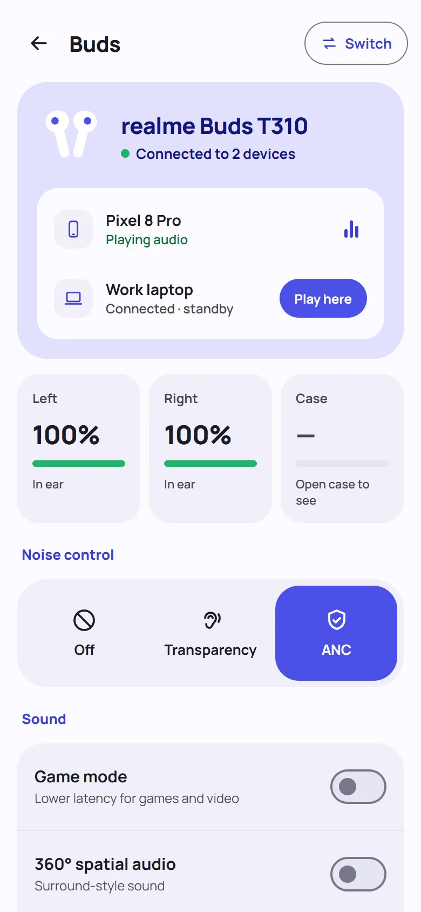
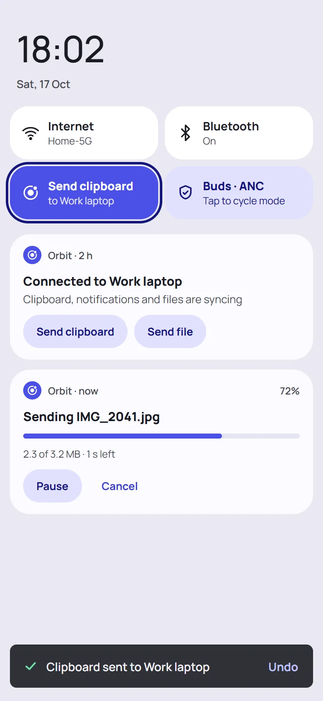

<div align="center">


# Orbit

**Your Android phone and Windows PC, working as one.**

Orbit connects your phone and PC directly. Share your clipboard, see notifications, move files, mirror your
screen and control media and earbuds, with no account and no cloud in between.

[**Website**](https://mohib-76.github.io/orbit/) · [**Download**](https://github.com/Mohib-76/orbit/releases/latest) · [Troubleshooting](docs/TROUBLESHOOTING.md) · [Privacy](PRIVACY.md)

[](https://github.com/Mohib-76/orbit/actions/workflows/ci.yml)
[](https://github.com/Mohib-76/orbit/releases/latest)
[](LICENSE)


<br>

<picture>
  <source media="(prefers-color-scheme: dark)" srcset="site/img/dashboard-dark.webp">
  
</picture>

</div>

## Why Orbit

- **Direct and private.** Data moves only between your two devices, over mutual TLS with certificates pinned at
  pairing. There is no Orbit server, no account and no analytics.
- **Connects over whatever is available.** A USB cable, USB tethering, your phone's hotspot or a shared Wi-Fi
  network. Orbit tries every route at once and keeps the first one that answers, with no firewall rules or setup.
- **Free and open source.** Licensed under AGPL-3.0, with no ads, subscriptions or in-app purchases.

## Features

| | |
|---|---|
| **Universal clipboard** | Copy on your PC and paste on your phone, automatically. Send text from your phone with one tap: a button, a Quick Settings tile, a notification action, or by sharing text to Orbit. Copies marked private by password managers are never synced |
| **Notifications** | Phone notifications appear as native Windows notifications with app icons. Dismiss one on your PC and it clears on your phone. Choose which apps forward, hide message text, pause, or silence alerts while your PC is locked |
| **File transfer** | Drag and drop files onto Orbit, or choose *Share → Orbit* on your phone. Transfers show progress and resume automatically if the connection drops |
| **Screen mirroring** | View and control your phone from your PC with mouse, keyboard and audio. Capture screenshots and recordings. Works over USB, or over Wi-Fi after a one-time setup |
| **Media controls** | See what's playing on either device, then play, pause, skip or seek from the other. Phone audio appears in the Windows media controls, and PC playback in the phone's media player |
| **Links** | Share a link to *Open on your PC* and it opens in the PC's browser. Copy a link on the PC and send it to the phone from the tray or with Ctrl+Alt+L |
| **Phone remote** | Change or mute the PC's volume, lock it, put it to sleep or shut it down from the phone, and run your own commands. The PC decides which buttons the phone gets, and every action shows a notification there |
| **Phone battery** | Charge level, charging state and time to full in the app, the system tray and the tray flyout, with a low-battery alert |
| **USB modes** | Choose what the cable does: charging only, USB tethering (your laptop goes online through your phone) or file sharing (your phone opens in File Explorer). Switch at any time from either device |
| **Earbuds** | Battery and Play Here for any Bluetooth earbuds. Noise control (Off / Transparency / ANC), sound settings and tap actions for supported realme, OnePlus and OPPO models, on both devices |
| **Pairing** | Scan a QR code, or plug in your phone and select **Pair over USB** |

## Screenshots

<table>
  <tr>
    <td width="50%"><picture><source media="(prefers-color-scheme: dark)" srcset="site/img/clipboard-dark.webp"></picture><p align="center"><b>Clipboard</b></p></td>
    <td width="50%"><picture><source media="(prefers-color-scheme: dark)" srcset="site/img/notifications-dark.webp"></picture><p align="center"><b>Notifications</b></p></td>
  </tr>
  <tr>
    <td colspan="2"><picture><source media="(prefers-color-scheme: dark)" srcset="site/img/mirror-dark.webp"></picture><p align="center"><b>Screen mirroring</b></p></td>
  </tr>
</table>

<table>
  <tr>
    <td width="25%"><picture><source media="(prefers-color-scheme: dark)" srcset="site/img/phone-dark.webp"></picture><p align="center"><b>Android home</b></p></td>
    <td width="25%"><picture><source media="(prefers-color-scheme: dark)" srcset="site/img/share-sheet-dark.webp"></picture><p align="center"><b>Share to PC</b></p></td>
    <td width="25%"><picture><source media="(prefers-color-scheme: dark)" srcset="site/img/buds-dark.webp"></picture><p align="center"><b>Earbuds</b></p></td>
    <td width="25%"><picture><source media="(prefers-color-scheme: dark)" srcset="site/img/shortcuts-dark.webp"></picture><p align="center"><b>Quick Settings</b></p></td>
  </tr>
</table>

<sub>Screens from Orbit's design files, shown with sample data.</sub>

### Requirements by feature

| Feature | Requires |
|---|---|
| Clipboard, notifications, files, battery, media controls, links, phone remote | Nothing extra: USB tethering, a hotspot or a shared Wi-Fi network |
| Pair over USB, USB modes, mirroring over USB | **USB debugging** on the phone ([how to enable it](docs/TROUBLESHOOTING.md#turn-on-usb-debugging)) |
| Mirroring over Wi-Fi | Wireless debugging (a one-time QR setup in Orbit) and both devices on the same Wi-Fi network |
| Earbuds | Earbuds paired over Bluetooth. Full controls require realme, OnePlus or OPPO earbuds that use the realme Link or HeyMelody app (tested with realme Buds T310); other brands show battery and playback. To add support for yours, see [Earbuds](docs/PROTOCOL.md#earbuds) |

## Install

**System requirements:** Windows 10 (1809) or Windows 11, x64 · Android 10 or later.

1. **Install on Windows.** Download `OrbitSetup-<version>.exe` from
   [Releases](https://github.com/Mohib-76/orbit/releases) and run it. Orbit runs in the system tray.
2. **Install on Android.** The simplest way: turn on
   [USB debugging](docs/TROUBLESHOOTING.md#turn-on-usb-debugging), connect your phone and select
   **Install on phone** on the PC's pairing screen. Orbit installs the Android app and pairs both devices in one step.

   Alternatively, download `Orbit-<version>-android.apk` from the same release and install it, allowing installs
   from your browser or file manager when prompted. Some phones block this with "App blocked to protect your
   device"; in that case, install over USB ([why](docs/TROUBLESHOOTING.md#app-blocked-to-protect-your-device)).
3. **Grant permissions.** Open Orbit on your phone and allow the permissions it requests. Notification access and
   "stay connected" are the most important.
4. **Pair** (if you didn't install over USB). Connect with USB debugging on and select **Pair over USB** on your PC,
   or tap **Scan QR code** on your phone and point it at your PC.

To verify your download, compare its SHA-256 against `SHA256SUMS.txt` in the release.

Need help? See [Troubleshooting](docs/TROUBLESHOOTING.md). Samsung, Xiaomi and some other manufacturers restrict
background apps aggressively; [dontkillmyapp.com](https://dontkillmyapp.com) has instructions for each brand.

## Privacy and security

Orbit has no servers, no account and no analytics. Your data travels only between your own two devices, encrypted
with TLS using keys pinned when you pair. Read the [privacy policy](PRIVACY.md) for details, and report
vulnerabilities as described in [SECURITY.md](SECURITY.md).

## Build from source

Requires Windows with the .NET 8 SDK and JDK 17–21:

```powershell
.\tools\fetch-thirdparty.ps1   # scrcpy server, FFmpeg and adb binaries (checksum-verified)
.\build.ps1                    # both apps into .\dist
dotnet test windows\Orbit.Tests
cd android; .\gradlew.bat testDebugUnitTest
```

[docs/ARCHITECTURE.md](docs/ARCHITECTURE.md) explains how Orbit works, and [docs/PROTOCOL.md](docs/PROTOCOL.md)
documents the wire protocol. Contributions are welcome; please read [CONTRIBUTING.md](CONTRIBUTING.md) first.

## Known limitations

- Clipboard sync supports text only.
- Android only lets the app in the foreground read the clipboard, so sending from phone to PC takes a tap. PC to
  phone is automatic.
- Orbit connects one phone to one PC at a time.
- Orbit can't turn on your phone's hotspot (Android doesn't allow apps to), but it connects as soon as your laptop
  joins it.
- The QR scanner uses Google Play services, so this build isn't on F-Droid yet. Pair over USB works without it.

## License

Orbit is free software licensed under the [GNU Affero General Public License v3.0](LICENSE). It builds on
[scrcpy](https://github.com/Genymobile/scrcpy) and [FFmpeg](https://ffmpeg.org), with earbuds protocol research
from [Gadgetbridge](https://codeberg.org/Freeyourgadget/Gadgetbridge) and ideas from
[KDE Connect](https://kdeconnect.kde.org); see [THIRD_PARTY_NOTICES.md](THIRD_PARTY_NOTICES.md).

Orbit is an independent project and is not affiliated with realme, OnePlus, OPPO, Samsung, Google, Microsoft or
Genymobile.
